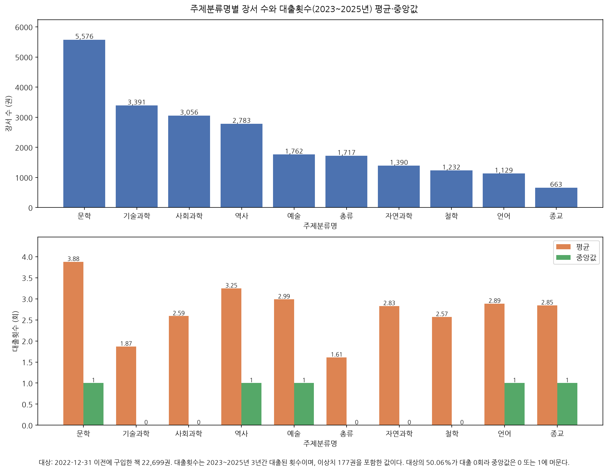

# 결과 — 주제별 대출횟수·이상치·구입가격과 2027년 예산 배분 근거 (질문 4)

**검증 일치 357/357 (검증/대조표.md), 표·그림 대조 일치, 규칙 위반 0 (검증/규칙점검표.md).**

작성: 분석 담당 / 2026-11-18. 산출 코드: `작업/20261117_주제별_예산근거/분석/분석.py` (프로젝트 폴더에서 `.venv/bin/python 작업/20261117_주제별_예산근거/분석/분석.py`). 난수 없음, 시드 없음.
이 파일은 분석.py가 만든다. "분석.py n"은 그 파일의 n번째 줄이다. 모든 수치는 `분석/핵심수치.csv`의 같은 번호 값이다 (주제별 번호 N = 28 + 33j + f, 계산명세 6-3절).
입력: `P02_장서목록_대출횟수 original.csv` 28000행 (N1, 분석.py 94). 대상: 구입일 2022-12-31 이하 22699권 (N2, 분석.py 95). 대상 밖(2023년 이후 구입) 5301권 (N27, 분석.py 121).

## 맨 앞: 이상치 처리에 따른 순위 차이

대출횟수 이상치 177권을 빼면 대출 평균 순위가 바뀌는 주제는 8개, 대출 비중 순위가 바뀌는 주제는 2개다 (대출 평균 순위: 기술과학 9위 → 10위, 사회과학 7위 → 8위, 역사 2위 → 4위, 총류 10위 → 9위, 자연과학 6위 → 7위, 철학 8위 → 6위, 언어 4위 → 5위, 종교 5위 → 2위; 대출 비중 순위: 자연과학 6위 → 7위, 언어 7위 → 6위). 순위 1 = 가장 큼. 근거: 핵심 수치 f4·f9·f31·f32 (분석.py 160).

## 산출물 ② 주제별 장서 수와 대출횟수 (표 1, 그림 1)

| 주제분류명 | 유지 권수 | 유지 대출 합 | 유지 평균 | 유지 중앙값 | 유지 평균 순위 | 제외 권수 | 제외 대출 합 | 제외 평균 | 제외 중앙값 | 제외 평균 순위 |
|---|---|---|---|---|---|---|---|---|---|---|
| 문학 | 5576 | 21632 | 3.88 | 1 | 1 | 5524 | 16684 | 3.02 | 1 | 1 |
| 기술과학 | 3391 | 6335 | 1.87 | 0 | 9 | 3374 | 4580 | 1.36 | 0 | 10 |
| 사회과학 | 3056 | 7915 | 2.59 | 0 | 7 | 3028 | 5327 | 1.76 | 0 | 8 |
| 역사 | 2783 | 9038 | 3.25 | 1 | 2 | 2750 | 6351 | 2.31 | 1 | 4 |
| 예술 | 1762 | 5267 | 2.99 | 1 | 3 | 1749 | 4216 | 2.41 | 1 | 3 |
| 총류 | 1717 | 2763 | 1.61 | 0 | 10 | 1713 | 2511 | 1.47 | 0 | 9 |
| 자연과학 | 1390 | 3934 | 2.83 | 0 | 6 | 1382 | 2521 | 1.82 | 0 | 7 |
| 철학 | 1232 | 3167 | 2.57 | 0 | 8 | 1224 | 2518 | 2.06 | 0 | 6 |
| 언어 | 1129 | 3259 | 2.89 | 1 | 4 | 1119 | 2576 | 2.30 | 1 | 5 |
| 종교 | 663 | 1887 | 2.85 | 1 | 5 | 659 | 1677 | 2.54 | 1 | 2 |
| 대상 전체 | 22699 | 65197 | 2.87 | 0 |  | 22522 | 48961 | 2.17 | 0 |  |

- 대상: 2022-12-31 이전에 구입한 책 (대출을 센 2023~2025년보다 먼저 구입). 그 책이 3년 동안 서가에 계속 있었는지는 이 자료로 알 수 없다.
- 대출횟수: 2023~2025년 3년간 대출된 횟수의 합 (한 칸).
- 제외 = 대출횟수 36.4227회 초과 또는 -30.6783회 미만인 177권을 뺀 값. 경계는 대상 전체의 평균 ± 3 × 표본 표준편차다. 표준편차는 값이 평균에서 흩어진 정도이고, 표본 표준편차는 그것을 구할 때 권수 n 대신 n−1로 나누는 방식이다 (질문 3과 같음). 평균±3표준편차는 평균에서 표준편차의 3배보다 멀리 떨어진 값을 이상치로 보는 기준이다.
- 중앙값은 값을 크기순으로 놓았을 때 가운데 값이다. 중앙값 규칙: 권수가 짝수여도 두 값의 평균을 내지 않고 가운데 쪽 앞의 실제 값(⌈n/2⌉번째)을 쓴다.
- 순위 1 = 평균이 가장 큼. 대상의 11363권(50.06%)이 대출 0회다 (N25 분석.py 118, N26 분석.py 120).
- 산출 코드: f0·f1·f5·f6 분석.py 141, f2 분석.py 145, f3 분석.py 146, f7 분석.py 147, f8 분석.py 148, f4·f9 분석.py 160, N8 분석.py 103, N9·N10 분석.py 104, N16 분석.py 111, N17 분석.py 112, N18 분석.py 113, N19 분석.py 114. 행 순서(유지 권수 내림차순) 분석.py 219.
- 표 파일: `분석/표1_주제별_장서수_대출횟수.csv`

그림 1: `분석/그림1_주제별_장서수_대출횟수_유지.png` (유지 처리만. 제외 처리는 표 1). 그림의 숫자는 핵심수치.csv 값과 같은지 코드로 대조했다.

대상의 50.06%가 대출 0회라 주제별 중앙값이 0 또는 1뿐이다. 중앙값으로는 주제 사이를 거의 가를 수 없어, 주제 비교는 평균과 대출 합으로 본다. (N26 분석.py 120, f3 분석.py 146, f8 분석.py 148)

## 산출물 ③ 대출횟수 이상치 (표 2)

| 주제분류명 | 대상 권수 | 이상치 권수 | 주제 안 이상치 비율% | 이상치 중 비중% | 권수 비중% | 차이 %p | 이상치 대출 합 | 주제 대출 합 중 이상치 비중% |
|---|---|---|---|---|---|---|---|---|
| 문학 | 5576 | 52 | 0.93 | 29.38 | 24.56 | 4.81 | 4948 | 22.87 |
| 기술과학 | 3391 | 17 | 0.50 | 9.60 | 14.94 | -5.33 | 1755 | 27.70 |
| 사회과학 | 3056 | 28 | 0.92 | 15.82 | 13.46 | 2.36 | 2588 | 32.70 |
| 역사 | 2783 | 33 | 1.19 | 18.64 | 12.26 | 6.38 | 2687 | 29.73 |
| 예술 | 1762 | 13 | 0.74 | 7.34 | 7.76 | -0.42 | 1051 | 19.95 |
| 총류 | 1717 | 4 | 0.23 | 2.26 | 7.56 | -5.30 | 252 | 9.12 |
| 자연과학 | 1390 | 8 | 0.58 | 4.52 | 6.12 | -1.60 | 1413 | 35.92 |
| 철학 | 1232 | 8 | 0.65 | 4.52 | 5.43 | -0.91 | 649 | 20.49 |
| 언어 | 1129 | 10 | 0.89 | 5.65 | 4.97 | 0.68 | 683 | 20.96 |
| 종교 | 663 | 4 | 0.60 | 2.26 | 2.92 | -0.66 | 210 | 11.13 |
| 대상 전체 | 22699 | 177 | 0.78 |  |  |  | 16236 | 24.90 |

- 이상치 기준: 평균 2.8722회 ± 3 × 표본 표준편차 11.1835회, 경계 -30.6783 ~ 36.4227회, 대상 전체 기준 하나 (주제별로 따로 구하지 않음). 이상치 대출횟수 범위 37~527회. (N3 분석.py 96, N4 분석.py 97, N5·N6 분석.py 98, 판정 분석.py 100, N14 분석.py 109, N15 분석.py 110)
- 차이 %p = 이상치 중 비중 − 권수 비중. %p(퍼센트포인트)는 두 비율의 차이를 뺄셈으로 나타낸 단위다 (10%와 12%의 차이는 2%p). 이상치가 주제와 관계없이 고르게 나왔다면 각 주제의 이상치 중 비중은 그 주제의 권수 비중과 같아진다. 양수 = 이상치 177권 안에서의 몫이 대상 전체 안에서의 몫보다 크다.
- 산출 코드: f10·f15 분석.py 142, f11 분석.py 149, f12 분석.py 150, f13 분석.py 151, f14 분석.py 152, f16 분석.py 153, N7 분석.py 103, N11 분석.py 104, N12 분석.py 107, N13 분석.py 108.
- 표 파일: `분석/표2_대출이상치_주제별.csv`

대상 전체 기준 평균±3표준편차로 고른 이상치는 177권(대상의 0.78%)이고, 대출 합의 24.90%를 차지한다. 이상치 중 비중이 권수 비중보다 높은 주제는 역사(+6.38%p), 문학(+4.81%p), 사회과학(+2.36%p), 언어(+0.68%p)이고, 낮은 주제는 기술과학(-5.33%p), 총류(-5.30%p), 자연과학(-1.60%p), 철학(-0.91%p), 종교(-0.66%p), 예술(-0.42%p)이다. 이것은 센 값의 비교다. 그 차이가 우연히 생길 수 있는 범위를 넘는지는 검정하지 않아 말할 수 없고, 주제마다 이상치가 4~52권이라 몇 권 차이로 비중이 크게 움직인다. (N7 분석.py 103, N12 분석.py 107, N13 분석.py 108, f10 분석.py 142, f14 분석.py 152)

## 산출물 ④ 주제별 구입가격 (표 3)

| 주제분류명 | 권수 | 구입가격 합 | 평균 | 평균 순위 | 중앙값 |
|---|---|---|---|---|---|
| 문학 | 5576 | 93865000 | 16833.75 | 4 | 17000 |
| 기술과학 | 3391 | 56593500 | 16689.32 | 7 | 16500 |
| 사회과학 | 3056 | 50948000 | 16671.47 | 8 | 16500 |
| 역사 | 2783 | 47100000 | 16924.18 | 2 | 17000 |
| 예술 | 1762 | 29358500 | 16662.03 | 9 | 16500 |
| 총류 | 1717 | 28753000 | 16746.07 | 6 | 16500 |
| 자연과학 | 1390 | 23595000 | 16974.82 | 1 | 17000 |
| 철학 | 1232 | 20658000 | 16767.86 | 5 | 16500 |
| 언어 | 1129 | 19024500 | 16850.75 | 3 | 17000 |
| 종교 | 663 | 10939500 | 16500.00 | 10 | 16500 |
| 대상 전체 | 22699 | 380835000 | 16777.61 |  | 16500 |

- 구입가격은 코드북 2절의 '자료 구입 단가'(원)다. 대상 책 = 2022-12-31 이전 구입분. 주제별 평균의 최대−최소 차이 474.82원(대상 평균의 2.83%). 중앙값은 ⌈n/2⌉번째 실제 값이며 순위를 매기지 않는다.
- 산출 코드: f17 분석.py 142, f18 분석.py 154, f19 분석.py 155, f20 분석.py 160, N20 분석.py 105, N21 분석.py 116, N22 분석.py 117, N23 분석.py 178, N24 분석.py 180.
- 표 파일: `분석/표3_주제별_구입가격.csv`

주제별 구입가격 평균은 종교 16500.00원 ~ 자연과학 16974.82원으로, 차이가 474.82원(대상 평균 16777.61원의 2.83%)이다. 중앙값은 16500원(기술과학·사회과학·예술·총류·철학·종교), 17000원(문학·역사·자연과학·언어)이며 순위를 매기지 않았다. 평균 순위(f20)로 주제 사이 가격 차이를 말할 때는 이 차이 474.82원(대상 평균의 2.83%)과 함께 읽는다. (f18 분석.py 154, f19 분석.py 155, f20 분석.py 160, N21 분석.py 116, N23 분석.py 178, N24 분석.py 180)

## 산출물 ⑤ 배분 근거 지표 (표 4)

| 주제분류명 | 권수 비중% | 대출 비중% 유지 | 대출 비중 순위 유지 | 대출 비중% 제외 | 대출 비중 순위 제외 | 가격합 비중% | 구입가격 평균 |
|---|---|---|---|---|---|---|---|
| 문학 | 24.56 | 33.18 | 1 | 34.08 | 1 | 24.65 | 16833.75 |
| 기술과학 | 14.94 | 9.72 | 4 | 9.35 | 4 | 14.86 | 16689.32 |
| 사회과학 | 13.46 | 12.14 | 3 | 10.88 | 3 | 13.38 | 16671.47 |
| 역사 | 12.26 | 13.86 | 2 | 12.97 | 2 | 12.37 | 16924.18 |
| 예술 | 7.76 | 8.08 | 5 | 8.61 | 5 | 7.71 | 16662.03 |
| 총류 | 7.56 | 4.24 | 9 | 5.13 | 9 | 7.55 | 16746.07 |
| 자연과학 | 6.12 | 6.03 | 6 | 5.15 | 7 | 6.20 | 16974.82 |
| 철학 | 5.43 | 4.86 | 8 | 5.14 | 8 | 5.42 | 16767.86 |
| 언어 | 4.97 | 5.00 | 7 | 5.26 | 6 | 5.00 | 16850.75 |
| 종교 | 2.92 | 2.89 | 10 | 3.43 | 10 | 2.87 | 16500.00 |
| 대상 전체 |  |  |  |  |  |  | 16777.61 |

- 분모: 권수 비중 = 대상 권수 22699권(N2), 대출 비중 유지 = 대상 대출 합 65197회(N9), 대출 비중 제외 = 제외 후 대출 합 48961회(N10), 가격합 비중 = 대상 구입가격 합 380835000원(N20). 비중은 하나씩 반올림해 열 합이 100.00과 조금 다를 수 있다.
- 권수 비중·가격합 비중·구입가격 평균은 두 처리 모두 대상 전체(유지) 값이다 (승인 7·8번).
- 산출 코드: f13 분석.py 151, f21 분석.py 156, f22 분석.py 157, f23 분석.py 158, f18 분석.py 154, f31·f32 분석.py 160.
- 표 파일: `분석/표4_배분근거지표.csv`

## 산출물 ⑤ 배분 비율 시나리오 (표 5, 단위 %)

| 주제분류명 | 시나리오 1 유지 | 시나리오 1 제외 | 시나리오 2 유지 | 시나리오 2 제외 | 시나리오 3 (대상 장서 구입가격 구성대로) | 시나리오 4 유지 | 시나리오 4 제외 |
|---|---|---|---|---|---|---|---|
| 문학 | 33.18 | 34.08 | 33.26 | 34.17 | 24.65 | 28.87 | 29.32 |
| 기술과학 | 9.72 | 9.35 | 9.66 | 9.30 | 14.86 | 12.33 | 12.15 |
| 사회과학 | 12.14 | 10.88 | 12.05 | 10.80 | 13.38 | 12.80 | 12.17 |
| 역사 | 13.86 | 12.97 | 13.97 | 13.08 | 12.37 | 13.06 | 12.61 |
| 예술 | 8.08 | 8.61 | 8.02 | 8.54 | 7.71 | 7.92 | 8.19 |
| 총류 | 4.24 | 5.13 | 4.23 | 5.11 | 7.55 | 5.90 | 6.35 |
| 자연과학 | 6.03 | 5.15 | 6.10 | 5.21 | 6.20 | 6.08 | 5.64 |
| 철학 | 4.86 | 5.14 | 4.85 | 5.14 | 5.42 | 5.14 | 5.28 |
| 언어 | 5.00 | 5.26 | 5.02 | 5.28 | 4.99 | 4.99 | 5.12 |
| 종교 | 2.89 | 3.43 | 2.84 | 3.37 | 2.87 | 2.91 | 3.17 |
| 대상 전체 | 100.00 | 100.00 | 100.00 | 100.00 | 100.00 | 100.00 | 100.00 |

열 이름의 '유지·제외'는 대출횟수 이상치 처리를 뜻한다. 식의 기호: B = 주제 권수, L = 처리별 주제 대출 합, P = 주제 구입가격 평균(유지 행), G = 주제 구입가격 합. 각 식은 10개 주제 합이 1이다.

- 시나리오 1. 대출 비중대로: a = L / ΣL (유지·제외). 가정: 2027년 예산 금액의 주제 구성을 2023~2025년 대출횟수의 주제 구성과 같게 둔다 (주제마다 책값이 다른 것은 반영하지 않음).
- 시나리오 2. 대출 비중 × 가격 평균: a = L·P / Σ(L·P) (유지·제외). 가정: 사들일 권수를 대출횟수 구성대로 나누고, 한 권 값은 대상 책의 그 주제 구입가격(자료 구입 단가) 평균과 같다고 보고 금액으로 바꾼다.
- 시나리오 3. 대상 장서 구입가격 구성대로: a = G / ΣG (대출 처리와 무관, 1개). 가정: 사들일 권수를 대상 책(2022-12-31 이전 구입분)의 주제별 권수 구성대로 나누고, 한 권 값은 그 주제 구입가격 평균과 같다고 본다 (= 대상 책 구입가격 합의 주제 구성 그대로).
- 시나리오 4. 권수와 대출의 중간: a = ½·(B / ΣB) + ½·(L / ΣL) (유지·제외). 가정: 대상 책(2022-12-31 이전 구입분)의 권수 구성과 2023~2025년 대출 구성을 같은 무게(반반)로 섞어 금액 구성으로 쓴다. 반반이라는 무게에는 근거가 없고 정한 값이다.
  시나리오 4의 반반(0.5·0.5) 무게는 이 자료나 다른 근거에서 나온 값이 아니라, 두 구성을 같은 무게로 섞어 보기 위해 정한 값이다.
- 최대 잔여 방식: 소수 둘째 자리 아래를 버린 뒤, 버린 몫이 큰 주제부터 0.01씩 더해 합을 100.00으로 맞추는 반올림 방법. 열마다 합이 정확히 100.00인지 코드로 확인했다.
- 이 값은 금액이 아니라 비율이다. 팀이 예산 총액을 정하면 '총액 × 비율'로 바꿀 수 있다.
- 산출 코드: 시나리오 1 분석.py 167, 2 분석.py 169, 3 분석.py 171, 4 분석.py 170, 최대 잔여 반올림 분석.py 174 (함수 largest_remainder).
- 표 파일: `분석/표5_배분비율_시나리오.csv`

시나리오 사이의 선택은 팀이 기획회의에서 한다. 이 비율은 금액이 아니며, 예산 총액이 이 자료에 없어 금액을 계산하지 않았다.

두 처리의 차이:
- 시나리오 1에서 |제외 − 유지|가 가장 큰 주제는 사회과학(-1.26%p)이다 (반올림한 표 값끼리 뺀 값이다, 제외 − 유지).
- 시나리오 2에서 |제외 − 유지|가 가장 큰 주제는 사회과학(-1.25%p)이다 (반올림한 표 값끼리 뺀 값이다, 제외 − 유지).
- 시나리오 4에서 |제외 − 유지|가 가장 큰 주제는 사회과학(-0.63%p)이다 (반올림한 표 값끼리 뺀 값이다, 제외 − 유지).

시나리오 비율은 합이 100.00이 되도록 최대 잔여 방식으로 반올림했다. 그래서 같은 식인 시나리오 1(유지)과 대출 비중(유지), 시나리오 1(제외)과 대출 비중(제외), 시나리오 3과 가격합 비중이 0.01%p 다를 수 있다.

## 산출물 ⑥ 한계와, 시나리오 식의 전제가 맞지 않을 수 있는 요인

시나리오 비율은 2027년의 대출이나 바른 배분을 미리 계산한 값이 아니다. 2023~2025년 대출 구성과 대상 책의 구성·구입가격을 정해진 식으로 나눈 비율이며, 아래는 그 식의 전제(예: 2023~2025년 구성이 2027년에도 이어진다)가 맞지 않을 수 있는 이유다.

- 가. 대출횟수는 2023-01-01~2025-12-30의 3년을 합친 한 칸이다. 해마다 늘었는지 줄었는지 알 수 없으므로, 2023~2025년의 대출 구성이 2027년에도 이어진다는 전제를 이 자료로 확인할 수 없다.
- 나. 2023년 이후 구입한 5301권은 대상에서 빠져 어느 비중에도 들어가지 않는다. 최근 3년 구입 경향은 반영되지 않았다.
- 다. 이상치 177권(대상의 0.78%)이 대출 합의 24.90%를 차지한다. 소수의 책이 대출 비중을 움직이며, 그 정도는 표 4·5의 유지·제외 열 차이로 보인다. 이상치 기준은 평균±3표준편차 하나만 썼고, 다른 기준(예: IQR)을 쓰면 제외 열 값이 달라질 수 있다.
- 라. 구입가격은 코드북의 '자료 구입 단가'다. 대상 책은 2005~2022년에 구입했으므로 이 단가는 그때의 값으로 읽힌다 (구입일에서 나온 해석이며 코드북 표현은 아니다). 2027년 단가는 이 자료에 없다. 시나리오 2·3의 가격 반영은 이 과거 단가 기준이다.
- 마. 대출 외 이용(관내 열람 등)은 이 자료에 없다 (코드북 7절 ③). 대출이 적은 주제가 덜 이용된다고 말할 수 없다.
- 바. 대상 책이 3년 동안 서가에 계속 있었는지(분실·제적·대출 불가 기간)는 알 수 없다.
- 사. 주제별 장서 보유량은 이 파일의 대상 권수로만 근사했다. 장서 회전율·이용계수처럼 도서관 전체 소장 장서를 분모로 쓰는 지표는 만들 수 없다.
- 아. 대출 비중이 큰 주제에 책이 더 필요하다는 뜻인지, 이미 많이 갖고 있어 대출이 많은 것인지는 이 자료로 가를 수 없다. 대출 비중대로 예산을 나누면 대출이 늘어난다고도 말할 수 없다 (관찰 자료, 규칙 9). 어느 기준을 쓸지는 팀의 판단이다.

## 산출물 ⑦ 분석할 수 없는 항목과 이유

| 항목 | 이유 | 근거 |
|---|---|---|
| 2027년 주제별 대출 수치를 미리 계산하는 방법(시계열·회귀·기계학습) | 대출횟수가 3년 합계 한 칸이라 연도별 흐름이 없다 | 코드북 2절, 질문.md '뺀 것' |
| 2027년 주제별 예산 금액 | 예산 총액이 어느 파일에도 없다 | 질문.md '뺀 것' |
| 2027년 단가·물가 반영 | 2027년 단가 자료가 없다. 구입가격은 대상 책의 '자료 구입 단가'다 | 코드북 2절 |
| 2023년 이후 구입 책의 대출 구성 | 대상에서 뺐다 (대출을 센 기간 안에 구입되어 대출 가능 기간이 책마다 다름) | 승인 1번 |
| 장서 회전율·이용계수 등 소장 장서 전체를 분모로 하는 지표 | 도서관 전체 주제별 소장 권수가 없다 (P03은 쓰지 않음) | 승인 4번 |
| 주제별 이용자 수·1인당 대출 | 이용자 정보가 없다 | 코드북 2절 |
| 책의 가치, 적정 장서량 | 가치 기준을 알 수 없다 | 맥락 파일 3절, 코드북 7절 ① |
| 대출 외 이용 | 관내 이용 기록이 없다 | 맥락 파일 3절, 코드북 7절 ③ |

## 검정

없음 (검정 0회). 대상 행을 모두 센 값이라 신뢰구간을 붙이지 않는다 (계산명세 5절).

## 수정 기록

| 날짜 | 고친 곳 | 내용 | 수치 영향 |
|---|---|---|---|
| 2026-11-18 | 맨 위 상태 표시 | '독립 검증 전'을 검증 결과(일치 357/357, 표·그림 대조 일치, 규칙 위반 0)로 바꿨다 (진행 담당 요청, 7단계) | 없음 |
| 2026-11-18 | 산출물 ⑥ 다 | '다른 기준(예: IQR)을 쓰면 제외 열 값이 달라진다'를 '달라질 수 있다'로 바꿨다. 다른 기준은 계산하지 않았으므로 단정하지 않는다 (진행 담당 요청) | 없음 |

두 곳 모두 분석.py의 문장 틀에서 고치고 분석.py를 다시 돌려 만들었다. 핵심수치.csv·표 CSV 5개·그림 1은 수정 전과 바이트 단위로 같다 (cmp).
