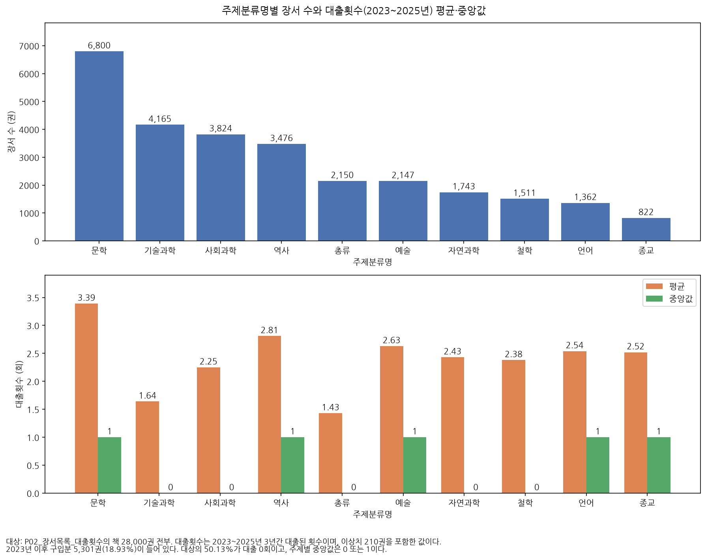

# 결과 — 주제별 대출횟수·이상치·구입가격과 2027년 예산 배분 근거, 전체 도서 (질문 4 다시 하기)

작성: 분석 담당 / 2026-11-25 (7단계)
대상: `P02_장서목록_대출횟수`의 28,000권 전부 (구입일 등으로 거르지 않음). '도서관 전체 장서'가 아니다.
수치 출처: `분석/핵심수치.csv` (N1~N378). 검증: `검증/대조표.md` 일치 378/378, 불일치 0. 이 문서의 수치는 모두 '일치'한 값이며, '검증 불일치'로 표시할 수치는 없다.
산출 코드: `작업/20261125_주제별_예산근거_전체도서/분석/분석.py` (아래 '분석.py:줄'은 이 파일의 줄 번호). 프로젝트 폴더에서 `.venv/bin/python 작업/20261125_주제별_예산근거_전체도서/분석/분석.py`로 처음부터 다시 돌릴 수 있다. 난수를 쓰지 않는다 (시드 없음).
검정: 하지 않았다 (검정 0회, 뜻은 끝 '용어' 절). 주제별로 세고 비율을 구한 기술분석과 정해진 식의 비율 계산이다. 이 파일의 대상 행을 모두 센 값이라 신뢰구간(같은 방법으로 조사를 반복하면 100번 중 약 95번은 실제 값을 포함하도록 만든 범위. 표본에서 전체를 추정할 때 쓴다)을 붙이지 않는다.

## 0. 이상치 처리에 따라 달라지는 것 (맨 앞, 규칙 4)

대출횟수 이상치 210권(N7)을 빼면 대출 평균 순위가 바뀌는 주제는 6개, 대출 비중 순위가 바뀌는 주제는 4개다.

- 대출 평균 순위 (유지 순위(유지 평균) → 제외 순위(제외 평균), 단위 회): 기술과학 9위(1.64) → 10위(1.21), 역사 2위(2.81) → 5위(2.00), 총류 10위(1.43) → 9위(1.28), 자연과학 6위(2.43) → 7위(1.59), 철학 7위(2.38) → 6위(1.84), 종교 5위(2.52) → 2위(2.28)
- 대출 비중 순위 (유지 순위(유지 비중) → 제외 순위(제외 비중)): 총류 9위(4.37%) → 8위(5.21%), 자연과학 6위(6.03%) → 7위(5.21%), 철학 7위(5.11%) → 6위(5.22%), 언어 8위(4.92%) → 9위(5.13%)

순위는 값이 조금만 달라도 바뀐다. 위 괄호 안의 값처럼, 순위가 바뀐 주제는 순위보다 표 1·표 4의 값으로 읽는다.

출처: 평균 순위 f4·f9 (분석.py:150), 평균 f2·f7 (분석.py:135, 137), 대출 비중 순위 f31·f32 (분석.py:151), 대출 비중 f21·f22 (분석.py:146, 147). 핵심 수치 번호는 N = 29 + 35j + f (j: 0 기술과학, 1 문학, 2 사회과학, 3 언어, 4 역사, 5 예술, 6 자연과학, 7 종교, 8 철학, 9 총류). 예: 역사 유지 평균 순위 N173, 제외 평균 순위 N178.

## 1. 산출물 ② 주제별 장서 수와 대출횟수 평균·중앙값 (표 1, 그림 1)

파일: `분석/표1_주제별_장서수_대출횟수.csv` (분석.py:250), `분석/그림1_주제별_장서수_대출횟수_유지.png` (분석.py:276~311)

| 주제분류명 | 유지 권수 | 유지 대출 합 | 유지 평균 | 유지 중앙값 | 유지 평균 순위 | 제외 권수 | 제외 대출 합 | 제외 평균 | 제외 중앙값 | 제외 평균 순위 | 2023년 이후 구입 권수 | 2023년 이후 구입 비율% |
|---|---|---|---|---|---|---|---|---|---|---|---|---|
| 문학 | 6800 | 23043 | 3.39 | 1 | 1 | 6737 | 17709 | 2.63 | 1 | 1 | 1224 | 18.00 |
| 기술과학 | 4165 | 6832 | 1.64 | 0 | 9 | 4146 | 5007 | 1.21 | 0 | 10 | 774 | 18.58 |
| 사회과학 | 3824 | 8604 | 2.25 | 0 | 8 | 3794 | 5945 | 1.57 | 0 | 8 | 768 | 20.08 |
| 역사 | 3476 | 9781 | 2.81 | 1 | 2 | 3437 | 6882 | 2.00 | 1 | 5 | 693 | 19.94 |
| 총류 | 2150 | 3072 | 1.43 | 0 | 10 | 2144 | 2750 | 1.28 | 0 | 9 | 433 | 20.14 |
| 예술 | 2147 | 5638 | 2.63 | 1 | 3 | 2130 | 4448 | 2.09 | 1 | 3 | 385 | 17.93 |
| 자연과학 | 1743 | 4244 | 2.43 | 0 | 6 | 1733 | 2753 | 1.59 | 0 | 7 | 353 | 20.25 |
| 철학 | 1511 | 3597 | 2.38 | 0 | 7 | 1501 | 2755 | 1.84 | 0 | 6 | 279 | 18.46 |
| 언어 | 1362 | 3464 | 2.54 | 1 | 4 | 1350 | 2711 | 2.01 | 1 | 4 | 233 | 17.11 |
| 종교 | 822 | 2075 | 2.52 | 1 | 5 | 818 | 1865 | 2.28 | 1 | 2 | 159 | 19.34 |
| 대상 전체 | 28000 | 70350 | 2.51 | 0 |  | 27790 | 52825 | 1.90 | 0 |  | 5301 | 18.93 |

표 1 각주
- 대상: `P02_장서목록_대출횟수`의 28,000권 전부 (N1·N2, 분석.py:84~85). 대출횟수는 2023~2025년 3년간 대출된 횟수(3년 합 한 칸)다.
- 유지 = 대상 전체 (주 결과). 제외 = 대출횟수 33.0172회(N6) 초과 또는 -27.9922회(N5) 미만인 210권(N7)을 뺌 (분석.py:90~98). 대출횟수는 0 이상이라 아래 경계에 걸리는 책은 없다.
- 순위 1 = 평균이 가장 큼 (같은 값은 공동 순위. 이번 결과에는 공동 순위가 없다).
- 대상의 50.13%(N26, 분석.py:116)가 대출 0회다.
- 2023년 이후 구입 비율 = 그 주제 책 가운데 구입일이 2023-01-01 이후인 책의 비율이며, 이상치 처리와 관계없이 그 주제 책 전체로 셈 (f33·f34, 분석.py:132, 149). 질문 3 전체 도서판(`작업/20261125_발행년주제_대출횟수_전체도서/`)의 발행년 표의 같은 이름 열은 처리마다 따로 셈했다.
- 대상 전체 행: N2, N9, N16, N17, N8, N10, N18, N19, N27, N28 (분석.py:85~120).
- 같은 처리 안에서 평균의 보고 값이 같은데 순위가 다른 주제는 없다.

중앙값: 대상의 50.13%(N26)가 대출 0회이고, 주제별 중앙값은 0 또는 1뿐이다. 중앙값으로는 주제 사이를 거의 가를 수 없어, 주제 비교는 평균과 대출 합으로 본다. (f3·f8, 분석.py:136, 138. 중앙값 = 값을 크기순으로 놓았을 때 가운데 값. 중앙값 규칙: 권수가 짝수여도 두 값의 평균을 내지 않고 가운데 쪽 앞의 실제 값, 곧 ⌈n/2⌉번째 값을 쓴다 — 분석.py:39~42.)

그림 1: 유지 처리만 그렸다. 위 칸은 장서 수(f0), 아래 칸은 대출 평균(f2)·중앙값(f3)이며 막대 순서는 유지 권수 내림차순이다. 그림의 숫자는 모두 핵심수치.csv 값이다.

## 2. 산출물 ③ 대출횟수 이상치와 주제 (표 2)

파일: `분석/표2_대출이상치_주제별.csv` (분석.py:256)

| 주제분류명 | 대상 권수 | 이상치 권수 | 주제 안 이상치 비율% | 이상치 중 비중% | 권수 비중% | 차이 %p | 이상치 대출 합 | 주제 대출 합 중 이상치 비중% |
|---|---|---|---|---|---|---|---|---|
| 문학 | 6800 | 63 | 0.93 | 30.00 | 24.29 | 5.71 | 5334 | 23.15 |
| 기술과학 | 4165 | 19 | 0.46 | 9.05 | 14.88 | -5.83 | 1825 | 26.71 |
| 사회과학 | 3824 | 30 | 0.78 | 14.29 | 13.66 | 0.63 | 2659 | 30.90 |
| 역사 | 3476 | 39 | 1.12 | 18.57 | 12.41 | 6.16 | 2899 | 29.64 |
| 총류 | 2150 | 6 | 0.28 | 2.86 | 7.68 | -4.82 | 322 | 10.48 |
| 예술 | 2147 | 17 | 0.79 | 8.10 | 7.67 | 0.43 | 1190 | 21.11 |
| 자연과학 | 1743 | 10 | 0.57 | 4.76 | 6.23 | -1.46 | 1491 | 35.13 |
| 철학 | 1511 | 10 | 0.66 | 4.76 | 5.40 | -0.63 | 842 | 23.41 |
| 언어 | 1362 | 12 | 0.88 | 5.71 | 4.86 | 0.85 | 753 | 21.74 |
| 종교 | 822 | 4 | 0.49 | 1.90 | 2.94 | -1.03 | 210 | 10.12 |
| 대상 전체 | 28000 | 210 | 0.75 |  |  |  | 17525 | 24.91 |

표 2 각주
- 이상치 기준: 평균 2.5125회(N3) ± 3 × 표준편차 10.1682회(N4), 경계 -27.9922(N5) ~ 33.0172회(N6), 대상 전체 기준 하나 (주제별로 따로 구하지 않음; 분석.py:90~96). 대출횟수는 0 이상이라 아래 경계에 걸리는 책은 없다.
  - 표준편차: 값이 평균에서 흩어진 정도. 표본 표준편차: 흩어진 정도를 구할 때 권수 n 대신 n−1로 나누는 방식 (ddof=1).
  - 평균±3표준편차: 평균에서 표준편차의 3배보다 멀리 떨어진 값을 이상치로 보는 기준.
- 이상치 대출횟수 범위 34~527회 (N14·N15, 분석.py:106~107).
- 차이 %p(f14) = 이상치 중 비중 − 권수 비중 (분석.py:142). 이상치가 주제와 관계없이 고르게 나왔다면 각 주제의 이상치 중 비중은 그 주제의 권수 비중과 같아진다. 그래서 둘의 차이로 '권수에 비해 이상치가 많은 쪽/적은 쪽'을 말한다. %p(퍼센트포인트): 두 비율의 차이를 뺄셈으로 나타낸 단위 (10%와 12%의 차이는 2%p).
- 출처: f10 (분석.py:129), f11 (139), f12 (140), f13 (141), f15 (130), f16 (143), N7 (97), N11 (103), N12 (104), N13 (105).

대상 전체 기준 평균±3표준편차로 고른 이상치는 210권(대상의 0.75%)이고, 대출 합의 24.91%를 차지한다. 이상치 중 비중이 권수 비중보다 높은 주제는 역사(+6.16%p), 문학(+5.71%p), 언어(+0.85%p), 사회과학(+0.63%p), 예술(+0.43%p)이고, 낮은 주제는 기술과학(-5.83%p), 총류(-4.82%p), 자연과학(-1.46%p), 종교(-1.03%p), 철학(-0.63%p)이다. 이것은 센 값의 비교다. 그 차이가 우연히 생길 수 있는 범위를 넘는지는 검정하지 않아 말할 수 없고, 주제마다 이상치가 4~63권이라 몇 권 차이로 비중이 크게 움직인다.

## 3. 산출물 ④ 주제별 구입가격 (자료 구입 단가) (표 3)

파일: `분석/표3_주제별_구입가격.csv` (분석.py:261)

| 주제분류명 | 권수 | 구입가격 합 | 평균 | 평균 순위 | 중앙값 |
|---|---|---|---|---|---|
| 문학 | 6800 | 114409000 | 16824.85 | 3 | 17000 |
| 기술과학 | 4165 | 69679500 | 16729.77 | 7 | 16500 |
| 사회과학 | 3824 | 63815000 | 16688.02 | 9 | 16500 |
| 역사 | 3476 | 58900500 | 16944.91 | 2 | 17000 |
| 총류 | 2150 | 36110500 | 16795.58 | 5 | 17000 |
| 예술 | 2147 | 35902500 | 16722.17 | 8 | 16500 |
| 자연과학 | 1743 | 29655000 | 17013.77 | 1 | 17000 |
| 철학 | 1511 | 25286000 | 16734.61 | 6 | 16500 |
| 언어 | 1362 | 22893500 | 16808.74 | 4 | 16500 |
| 종교 | 822 | 13682000 | 16644.77 | 10 | 16500 |
| 대상 전체 | 28000 | 470333500 | 16797.63 |  | 16500 |

표 3 각주
- 구입가격은 코드북 2절의 '자료 구입 단가'(원)다.
- 주제별 평균의 최대−최소 차이 369.00원(N23, 분석.py:166), 대상 평균 16797.63원(N21, 분석.py:113)의 2.20%(N24, 분석.py:167).
- 중앙값 정의: ⌈n/2⌉번째 실제 값 (분석.py:39~42). 중앙값에는 순위를 매기지 않는다.
- 출처: f17 (분석.py:131), f18 (144), f19 (145), f20 (150), N20 (112), N22 (114).
- 평균의 보고 값이 같은데 순위가 다른 주제는 없다.

주제별 구입가격(자료 구입 단가) 평균은 종교 16644.77원 ~ 자연과학 17013.77원으로, 차이가 369.00원(대상 평균 16797.63원의 2.20%)이다. 중앙값은 16500원(기술과학·사회과학·예술·철학·언어·종교), 17000원(문학·역사·총류·자연과학)이며 순위를 매기지 않았다.

## 4. 산출물 ⑤ 배분 근거 지표 (표 4)

파일: `분석/표4_배분근거지표.csv` (분석.py:265)

| 주제분류명 | 권수 비중% | 대출 비중% 유지 | 대출 비중 순위 유지 | 대출 비중% 제외 | 대출 비중 순위 제외 | 가격합 비중% | 구입가격 평균 | 2023년 이후 구입 비율% |
|---|---|---|---|---|---|---|---|---|
| 문학 | 24.29 | 32.75 | 1 | 33.52 | 1 | 24.33 | 16824.85 | 18.00 |
| 기술과학 | 14.88 | 9.71 | 4 | 9.48 | 4 | 14.81 | 16729.77 | 18.58 |
| 사회과학 | 13.66 | 12.23 | 3 | 11.25 | 3 | 13.57 | 16688.02 | 20.08 |
| 역사 | 12.41 | 13.90 | 2 | 13.03 | 2 | 12.52 | 16944.91 | 19.94 |
| 총류 | 7.68 | 4.37 | 9 | 5.21 | 8 | 7.68 | 16795.58 | 20.14 |
| 예술 | 7.67 | 8.01 | 5 | 8.42 | 5 | 7.63 | 16722.17 | 17.93 |
| 자연과학 | 6.23 | 6.03 | 6 | 5.21 | 7 | 6.31 | 17013.77 | 20.25 |
| 철학 | 5.40 | 5.11 | 7 | 5.22 | 6 | 5.38 | 16734.61 | 18.46 |
| 언어 | 4.86 | 4.92 | 8 | 5.13 | 9 | 4.87 | 16808.74 | 17.11 |
| 종교 | 2.94 | 2.95 | 10 | 3.53 | 10 | 2.91 | 16644.77 | 19.34 |
| 대상 전체 |  |  |  |  |  |  | 16797.63 | 18.93 |

표 4 각주
- 분모: 권수 비중 = f0 ÷ 28,000권(N2) (분석.py:141), 대출 비중 유지 = f1 ÷ 70350회(N9) (146), 대출 비중 제외 = f6 ÷ 52825회(N10) (147), 가격합 비중 = f17 ÷ 470333500원(N20) (148).
- 각 비중은 하나씩 반올림해 열 합이 100.00과 조금 다를 수 있다. 순위는 반올림 전 정확한 값으로 매겼다 (f31·f32, 분석.py:151).
- 총류와 자연과학은 표의 값이 5.21%로 같지만 반올림 전 값으로 순위를 매겨 8위·7위다 (대출 비중 제외 f22·f32; 총류 N366·N376, 자연과학 N261·N271).
- 2023년 이후 구입 비율 열은 아래 6절 나 문장과 함께 읽는다.
- 대출 비중은 2023~2025년 3년간 대출된 횟수의 주제 구성만 뜻한다.

## 5. 산출물 ⑤ 배분 비율 시나리오 (표 5)

파일: `분석/표5_배분비율_시나리오.csv` (분석.py:270). 시나리오 식 (분석.py:153~164), 최대 잔여 반올림 (분석.py:50~67). 열 이름의 '유지·제외'는 대출횟수 이상치 처리를 뜻한다.

| 주제분류명 | 시나리오 1 유지 | 시나리오 1 제외 | 시나리오 2 유지 | 시나리오 2 제외 | 시나리오 3 (대상 장서 구입가격 구성대로) | 시나리오 4 유지 | 시나리오 4 제외 |
|---|---|---|---|---|---|---|---|
| 문학 | 32.76 | 33.52 | 32.79 | 33.56 | 24.32 | 28.52 | 28.90 |
| 기술과학 | 9.71 | 9.48 | 9.67 | 9.44 | 14.81 | 12.29 | 12.18 |
| 사회과학 | 12.23 | 11.25 | 12.14 | 11.18 | 13.57 | 12.94 | 12.46 |
| 역사 | 13.90 | 13.03 | 14.02 | 13.14 | 12.52 | 13.16 | 12.72 |
| 총류 | 4.37 | 5.21 | 4.36 | 5.20 | 7.68 | 6.02 | 6.44 |
| 예술 | 8.02 | 8.42 | 7.97 | 8.38 | 7.63 | 7.84 | 8.04 |
| 자연과학 | 6.03 | 5.21 | 6.11 | 5.28 | 6.31 | 6.13 | 5.72 |
| 철학 | 5.11 | 5.22 | 5.09 | 5.19 | 5.38 | 5.26 | 5.31 |
| 언어 | 4.92 | 5.13 | 4.93 | 5.13 | 4.87 | 4.90 | 5.00 |
| 종교 | 2.95 | 3.53 | 2.92 | 3.50 | 2.91 | 2.94 | 3.23 |
| 대상 전체 | 100.00 | 100.00 | 100.00 | 100.00 | 100.00 | 100.00 | 100.00 |

시나리오 식과 그 식이 가정하는 것 (B = 권수, L = 처리별 대출 합, P = 구입가격 평균, G = 구입가격 합)
- 시나리오 1. 대출 비중대로 (a = L / ΣL): 2027년 예산 금액의 주제 구성을 2023~2025년 대출횟수의 주제 구성과 같게 둔다 (주제마다 책값이 다른 것은 반영하지 않음).
- 시나리오 2. 대출 비중 × 가격 평균 (a = L·P / Σ L·P): 사들일 권수를 대출횟수 구성대로 나누고, 한 권 값은 대상 책의 그 주제 구입가격(자료 구입 단가) 평균과 같다고 보고 금액으로 바꾼다.
- 시나리오 3. 대상 장서 구입가격 구성대로 (a = G / ΣG): 사들일 권수를 대상 책(`P02_장서목록_대출횟수`의 28,000권)의 주제별 권수 구성대로 나누고, 한 권 값은 그 주제 구입가격 평균과 같다고 본다 (= 대상 책 구입가격 합의 주제 구성 그대로).
- 시나리오 4. 권수와 대출의 중간 (a = ½·B/ΣB + ½·L/ΣL): 대상 책(`P02_장서목록_대출횟수`의 28,000권)의 권수 구성과 2023~2025년 대출 구성을 같은 무게(반반)로 섞어 금액 구성으로 쓴다. 반반이라는 무게에는 근거가 없고 정한 값이다.
  시나리오 4의 반반(0.5·0.5) 무게는 이 자료나 다른 근거에서 나온 값이 아니라, 두 구성을 같은 무게로 섞어 보기 위해 정한 값이다.

시나리오 사이의 선택은 팀이 기획회의에서 한다. 이 비율은 금액이 아니며, 예산 총액이 이 자료에 없어 금액을 계산하지 않았다. 팀이 예산 총액을 정하면 '총액 × 비율'로 바꿀 수 있다.

두 처리 (반올림한 표 값끼리 뺀 값이다)
- 시나리오 1: 제외 열과 유지 열의 차이가 가장 큰 주제는 사회과학 -0.98%p (11.25 − 12.23).
- 시나리오 2: 가장 큰 주제는 사회과학 -0.96%p (11.18 − 12.14).
- 시나리오 4: 가장 큰 주제는 사회과학 -0.48%p (12.46 − 12.94).
  번호: 사회과학 시나리오 1 유지 N123, 제외 N124 / 시나리오 2 유지 N125, 제외 N126 / 시나리오 4 유지 N128, 제외 N129.

반올림: 시나리오 비율은 합이 100.00이 되도록 최대 잔여 방식으로 반올림했다. 그래서 같은 식인 시나리오 1(유지)과 대출 비중(유지), 시나리오 1(제외)과 대출 비중(제외), 시나리오 3과 가격합 비중이 0.01%p 다를 수 있다. 최대 잔여 방식: 소수 둘째 자리 아래를 버린 뒤, 버린 몫이 큰 주제부터 0.01씩 더해 합을 100.00으로 맞추는 반올림 방법. 표 5 '대상 전체' 행의 100.00은 핵심 수치가 아니라 이 합 확인(분석.py:173~174)으로 보장되는 값이다.

## 6. 산출물 ⑥ 한계와, 시나리오 식의 전제가 맞지 않을 수 있는 요인

시나리오 비율은 2027년의 대출이나 바른 배분을 미리 계산한 값이 아니다. 2023~2025년 대출 구성과 대상 책의 구성·구입가격을 정해진 식으로 나눈 비율이며, 아래는 그 식의 전제(예: 2023~2025년 구성이 2027년에도 이어진다)가 맞지 않을 수 있는 이유다.

- 가. 대출횟수는 2023-01-01~2025-12-30의 3년을 합친 한 칸이다. 해마다 늘었는지 줄었는지 알 수 없으므로, 2023~2025년의 대출 구성이 2027년에도 이어진다는 전제를 이 자료로 확인할 수 없다.
- 나. 대상에는 2023년 이후 구입분 5301권(대상의 18.93%; N27·N28, 분석.py:117~120)이 들어 있다. 이 책들은 구입일 이전에는 대출될 수 없었으므로, 대출횟수를 센 2023~2025년 가운데 대출될 수 있었던 기간이 짧다. 주제별 2023년 이후 구입 비율은 언어 17.11% ~ 자연과학 20.25%다 (표 1·표 4; f34, 분석.py:149). [추정] 그래서 2023년 이후 구입분의 비율이 높은 주제는 대출 비중이 낮게 잡힐 수 있다. 이 영향의 크기는 이 판에서 계산하지 않았다. 구입일이 2022-12-31 이하인 책만을 대상으로 한 결과는 보관판 `작업/20261117_주제별_예산근거_보관_구입일2022이하/최종요약.md`에 있다. 이 판에서는 그 범위의 값을 다시 계산하지 않았다.
- 다. 이상치 210권(대상의 0.75%)이 대출 합의 24.91%를 차지한다. 소수의 책이 대출 비중을 움직이며, 그 정도는 표 4·5의 유지·제외 열 차이로 보인다. 이상치 기준은 평균±3표준편차 하나만 썼고, 다른 기준(예: IQR — 가운데 50% 값이 퍼진 폭(제3사분위수 − 제1사분위수)을 써서, 그 1.5배보다 멀리 떨어진 값을 이상치로 보는 기준)을 쓰면 제외 열 값이 달라질 수 있다.
- 라. 구입가격은 코드북의 '자료 구입 단가'다. 대상 책은 2005~2025년에 구입했으므로 [추정] 이 단가는 그때의 값으로 읽힌다 (구입일에서 나온 해석이며 코드북 표현은 아니다). 2027년 단가는 이 자료에 없다. 시나리오 2·3의 가격 반영은 이 과거 단가 기준이다.
- 마. 대출 외 이용(관내 열람 등)은 이 자료에 없다 (코드북 7절 ③). 대출이 적은 주제가 덜 이용된다고 말할 수 없다.
- 바. 대상 책이 구입 뒤 서가에 계속 있었는지(분실·제적·대출 불가 기간)는 알 수 없다.
- 사. 주제별 권수는 이 파일의 행 수이며, 도서관이 지금 가진 주제별 장서 전체인지는 알 수 없다. 장서 회전율·이용계수처럼 도서관 전체 소장 장서를 분모로 쓰는 지표는 만들 수 없다.
- 아. 대출 비중이 큰 주제에 책이 더 필요하다는 뜻인지, 이미 많이 갖고 있어 대출이 많은 것인지는 이 자료로 가를 수 없다. 대출 비중대로 예산을 나누면 대출이 늘어난다고도 말할 수 없다 (관찰 자료, 규칙 9). 어느 기준을 쓸지는 팀의 판단이다.

## 7. 산출물 ⑦ 분석할 수 없는 항목과 이유

| 항목 | 이유 | 근거 |
|---|---|---|
| 2027년 주제별 대출 수치를 미리 계산하는 방법(시계열·회귀·기계학습) | 대출횟수가 3년 합계 한 칸이라 연도별 흐름이 없다 | 코드북 2절, 질문.md '뺀 것' |
| 2027년 주제별 예산 금액 | 예산 총액이 어느 파일에도 없다 | 질문.md '뺀 것' |
| 2027년 단가·물가 반영 | 2027년 단가 자료가 없다. 구입가격은 대상 책의 '자료 구입 단가'다 | 코드북 2절 |
| 2023년 이후 구입분의 대출 가능 기간을 맞춘(보정한) 대출 구성 | 대출횟수가 3년 합계 한 칸이고, 구입 뒤 서가에 있던 기간을 알 수 없어 보정 기준이 없다 | 코드북 2절, 코드북에서 '삭제'로 정한 이용상태 열 |
| 장서 회전율·이용계수 등 소장 장서 전체를 분모로 하는 지표 | 도서관 전체 주제별 소장 권수가 없다 (P03은 쓰지 않음) | 승인 2번 |
| 주제별 이용자 수·1인당 대출 | 이용자 정보가 없다 | 코드북 2절 |
| 책의 가치, 적정 장서량 | 가치 기준을 알 수 없다 | 맥락 파일 3절, 코드북 7절 ① |
| 대출 외 이용 | 관내 이용 기록이 없다 | 맥락 파일 3절, 코드북 7절 ③ |

분석 프롬프트의 산출물 ①('예측' 방법과 선택 이유)은 위 첫 줄의 이유로 만들지 않았다.

## 8. 공통 수치 (N1~N28)

| 번호 | 항목 | 값 | 산출 코드 |
|---|---|---|---|
| N1 | 입력 행 수 | 28000 | 분석.py:84 |
| N2 | 대상 권수 | 28000 | 분석.py:85 |
| N3 | 대상 대출횟수 평균 | 2.5125 | 분석.py:96 |
| N4 | 대상 대출횟수 표본 표준편차 | 10.1682 | 분석.py:96 |
| N5 | 이상치 아래 경계 | -27.9922 | 분석.py:96 |
| N6 | 이상치 위 경계 | 33.0172 | 분석.py:96 |
| N7 | 이상치 권수 | 210 | 분석.py:97 |
| N8 | 제외 후 권수 | 27790 | 분석.py:98 |
| N9 | 유지 대상 대출 합 | 70350 | 분석.py:101 |
| N10 | 제외 후 대출 합 | 52825 | 분석.py:102 |
| N11 | 이상치 대출 합 | 17525 | 분석.py:103 |
| N12 | 이상치 대출 합 비중 | 24.91 | 분석.py:104 |
| N13 | 이상치 권수 비율 | 0.75 | 분석.py:105 |
| N14 | 이상치 대출횟수 최솟값 | 34 | 분석.py:106 |
| N15 | 이상치 대출횟수 최댓값 | 527 | 분석.py:107 |
| N16 | 유지 대상 대출 평균 | 2.51 | 분석.py:108 |
| N17 | 유지 대상 대출 중앙값 | 0 | 분석.py:109 |
| N18 | 제외 후 대출 평균 | 1.90 | 분석.py:110 |
| N19 | 제외 후 대출 중앙값 | 0 | 분석.py:111 |
| N20 | 대상 구입가격 합 | 470333500 | 분석.py:112 |
| N21 | 대상 구입가격 평균 | 16797.63 | 분석.py:113 |
| N22 | 대상 구입가격 중앙값 | 16500 | 분석.py:114 |
| N23 | 주제별 구입가격 평균의 최댓값 - 최솟값 | 369.00 | 분석.py:166 |
| N24 | N23의 대상 평균 대비 크기 | 2.20 | 분석.py:167 |
| N25 | 대상 대출 0회 권수 | 14036 | 분석.py:115 |
| N26 | 대상 대출 0회 비율 | 50.13 | 분석.py:116 |
| N27 | 2023년 이후 구입 권수 (대상 전체) | 5301 | 분석.py:117 |
| N28 | 2023년 이후 구입 비율 (대상 전체) | 18.93 | 분석.py:120 |

합 확인 (계산명세 6-6, 분석.py:169~174): N2 = N1, N7 + N8 = N2, N10 + N11 = N9, 주제별 합이 공통 수치와 같음, 시나리오 열 합 100.00 — 모두 통과.

## 9. 검증과 대조

- 6단계 독립 재계산 대조: `검증/대조표.md` 일치 378/378, 불일치 0.
- 원래 확정 값(`작업/20261118_주제별_예산근거_전체도서/`)과의 번호별 비교 (진행 담당): 378개 모두 같음.
- 질문 3 전체 도서판 다시 하기 판(`작업/20261125_발행년주제_대출횟수_전체도서/`) N3~N8과의 대조 (대상·이상치 정의가 같아 같은 값이어야 함, 진행 담당이 함): 진행 담당이 두 폴더의 핵심수치.csv를 비교했고, N3 2.5125, N4 10.1682, N5 -27.9922, N6 33.0172, N7 210, N8 27790으로 6개 모두 같다.

## 용어

- 중앙값: 값을 크기순으로 놓았을 때 가운데 값.
- 중앙값 규칙: 권수가 짝수여도 두 값의 평균을 내지 않고 가운데 쪽 앞의 실제 값을 쓴다.
- 표준편차: 값이 평균에서 흩어진 정도.
- 표본 표준편차: 흩어진 정도를 구할 때 권수 n 대신 n−1로 나누는 방식.
- 평균±3표준편차: 평균에서 표준편차의 3배보다 멀리 떨어진 값을 이상치로 보는 기준.
- %p(퍼센트포인트): 두 비율의 차이를 뺄셈으로 나타낸 단위. 10%와 12%의 차이는 2%p다.
- 최대 잔여 방식: 소수 둘째 자리 아래를 버린 뒤, 버린 몫이 큰 주제부터 0.01씩 더해 합을 100.00으로 맞추는 반올림 방법.
- 공동 순위: 정확한 값이 같은 주제에 같은 순위를 주는 방식.
- 검정: 관찰된 차이가 우연으로 생길 만한 정도인지 확률로 따지는 방법. 이 분석에서는 하지 않았다.
- 신뢰구간: 같은 방법으로 조사를 반복하면 100번 중 약 95번은 실제 값을 포함하도록 만든 범위(95% 신뢰구간). 이 결과는 대상 행을 모두 센 값이라 붙이지 않았다.
- IQR(사분위 범위): 값을 크기순으로 놓았을 때 가운데 50%가 퍼진 폭(제3사분위수 − 제1사분위수). 흔히 이 폭의 1.5배보다 멀리 떨어진 값을 이상치로 본다. 이 분석에서는 쓰지 않았다.
- 시계열 분석: 해마다·달마다처럼 시간 순서로 쌓인 값의 흐름을 보고 앞으로의 값을 계산하는 방법.
- 회귀: 한 값이 다른 값들과 어떻게 함께 움직이는지를 식으로 맞추는 방법.
- 기계학습: 컴퓨터가 많은 자료에서 규칙을 찾아 새 값을 계산하게 하는 방법.
